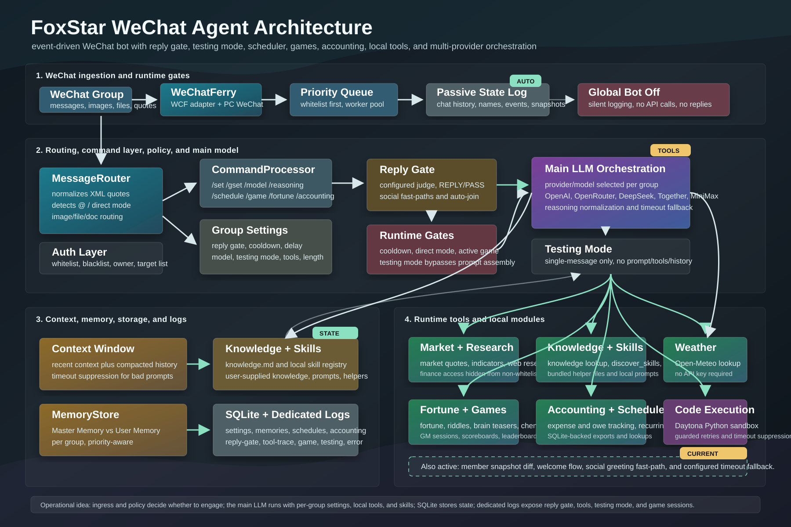

# FoxStar Agent

This repository is the open-source edition of the full FoxStar Agent WeChat bot agentic system. It includes the authored agent framework and Python WeChat adapter, automated workflows and scheduled tasks, remote operation through the control API, and debugging and diagnostic tools. Its capabilities include message routing, model switching, tool calls, background research, skills, and persistent memory.

Credentials, stored conversations, actual memory and knowledgebase content, deployment configuration, and third-party WeChat binaries are excluded. The code for these capabilities is preserved so you can configure and run your own instance.

## Try it offline

Use Python 3.10 or later. From the repository root:

```sh
python -m venv .venv
```

Activate the environment, then install and test:

```sh
python -m pip install -e ".[test]"
python -m pytest -q
```

The tests use synthetic inputs, temporary databases and mocked providers. They do not require WeChat, DLLs or API keys. Network connections are blocked during tests.

## Configure and run

Copy [config.example.yaml](config.example.yaml) to `config.yaml` and [.env.example](.env.example) to `.env`. Set your model credentials, owner identifier, permitted users/groups and transport connection locally. Configuration loading reads `.env`; the example credentials and owner are blank. The optional [JSON example](config.example.json) remains available for callers constructing configuration objects themselves.

The WeChat transport requires a separately installed `wcferry` client and a compatible runtime supplied by the operator. No SDK DLLs, vendor source trees, executables or release archives are included or installed by this package. With those external requirements configured, run from this checkout:

```sh
python app.py
```

`foxstar_bot.app.build_router(config_path, adapter=..., llm=...)` also accepts caller-supplied transport and model objects, so the framework can be exercised without loading WeChat. The adapter must implement the operations used by `MessageRouter`; see the fake adapters in the tests.

Optional integrations:

- HTTP control API: install `.[api]`, configure separate `AGENT_API_TOKEN_READ` and `AGENT_API_TOKEN_WRITE` secrets, then run `python -m foxstar_bot.agent_api`. It binds to localhost by default.
- Code execution: install `.[code]`, configure `DAYTONA_API_KEY`, and enable `tools.code_execution_enabled` locally.
- Clan service: configure your own endpoints, credentials and enabled groups. The bridge has no production endpoints or group IDs preconfigured.

Run the application from the checkout so it can find [PROMPT.md](PROMPT.md), [prompt templates](prompt_templates/) and [skills](skills/). These contain generic instructions. A local `knowledge.md` is optional and starts absent. SQLite is initialized on first use; no existing database or memory records are distributed. Expanded game datasets are also excluded; games use the built-in source-defined examples when external resources are absent.

The source distribution includes these startup assets and can be used from its extracted directory. The wheel contains the Python package; callers using only the wheel supply their own prompts, skills and configuration.

## Explore the code

[Architecture diagram (English)](docs/agent_architecture_flowchart.svg) · [架构图（中文）](docs/agent_architecture_flowchart_zh.svg)



| Component | Responsibility |
| --- | --- |
| [Application](foxstar_bot/app.py) | Assembles services, receives messages, runs workers and polls scheduled tasks. |
| [Router](foxstar_bot/router.py) | Applies reply gates, selects models, assembles context, dispatches tools and delivers replies. |
| [Commands](foxstar_bot/commands.py) | Handles configuration, schedules, memory, finance, games and administration. |
| [Model client](foxstar_bot/llm_client.py) | Adapts provider protocols, runs tool loops and records usage. |
| [Background tasks](foxstar_bot/agent_tasks.py) | Claims research jobs and stores progress and results. |
| [Research](foxstar_bot/tool_research.py) | Searches, reads pages and synthesizes reports. |
| [Skills](foxstar_bot/skills.py) | Discovers and loads skill instructions and companion code. |
| [Context](foxstar_bot/context_store.py) | Maintains recent history and rolling summaries. |
| [Persistence](foxstar_bot/persistence.py) | Stores messages, jobs, schedules, memory and delivery state in caller-owned SQLite. |
| [WeChat adapter](foxstar_bot/wcf_adapter.py) | Authored Python transport integration; loads external dependencies only when constructed. |

[Architecture and release boundary](docs/architecture.md) · [Release history](CHANGELOG.md)

FoxStar Agent is distributed under the [Apache License, Version 2.0](LICENSE).
